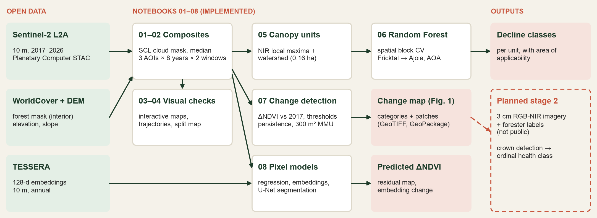
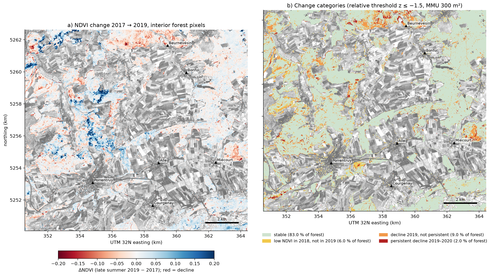

# Canopy decline after the 2018 drought in the Ajoie: a Sentinel-2 baseline for mapping beech dieback

**Course:** SDS320 Spatial Data Analytics (GeoAI), University of Zurich, autumn 2026
**Author:** David Leu
**Status (15 Nov 2026):** Sentinel-2 workflow implemented and run end to end (notebooks 01–08). The tree-level stage on aerial imagery is planned and depends on data access.

## Short summary

Beech stands in the Ajoie (Canton of Jura, Switzerland) were damaged after the dry summer of 2018. This project builds a reproducible Sentinel-2 workflow that maps where the forest canopy signal declined and stayed low, and tests how well that decline can be predicted one year ahead and transferred between regions. It uses open data only. It is the baseline for a later tree-level map of beech health on high-resolution RGB+NIR imagery, which needs imagery and forester labels that are not public.

## Project story in five sentences

1. **Question.** This project investigates where and how strongly forest canopy in the Ajoie declined after the 2018 drought, as a Sentinel-2 baseline for a later tree-level map of beech dieback.
2. **Data.** It uses Sentinel-2 L2A late-summer composites from 2017 to 2026 for the Ajoie and two comparison regions, with ESA WorldCover as forest mask.
3. **Method.** The workflow maps NDVI change against 2017 with a relative threshold and a persistence rule, and tests with spatial block cross-validation whether a Random Forest can predict the 2019 decline from the 2018 image.
4. **Result.** The main result shows that 2 % of interior forest (1.35 km²) stayed low in 2019 and 2020, clustered near Beurnevésin and Miécourt, and that the Random Forest (macro-F1 0.46 in the Ajoie) does not beat a simple threshold rule (0.53).
5. **Limitation.** The main limitation is that no field labels were available, so all scores measure agreement with a Sentinel-2 proxy, and a 10 m pixel is a group of trees, not a single crown.

## Research question

> Where did the forest canopy signal in the Ajoie decline after the 2018 drought and stay low, and how well can a model trained in a comparable region (Fricktal, AG) predict that decline from the drought-year image?

Sub-questions:

1. How much forest shows a persistent drop in late-summer NDVI, and how does the answer depend on the threshold strategy?
2. Does a Random Forest on Sentinel-2 features beat a simple threshold rule, and how much do random splits overstate its performance compared with spatial blocks?
3. Does the model transfer to the Ajoie and to a different forest type (Rhone valley, VS)?
4. Do pixel-level deep-learning models (U-Net regression and segmentation) or foundation-model embeddings (TESSERA) improve on these baselines?

The original, wider question (a two-stage deep-learning workflow with crown detection and ordinal health classification on 3 cm RGB+NIR imagery) is kept as the planned second stage: see [docs/project_proposal_two_stage.md](docs/project_proposal_two_stage.md).

## Data sources

| Dataset | Role | Resolution / period | Access | Licence |
|---|---|---|---|---|
| Sentinel-2 L2A | main imagery: 9 bands + SCL, indices NDVI, NDRE, CIre, NDMI, NBR | 10–20 m; 2017–2026, two windows per year | Microsoft Planetary Computer STAC, no login | Copernicus, free and open ("Contains modified Copernicus Sentinel data") |
| ESA WorldCover 2021 | forest mask (tree cover, shrunk by one pixel) | 10 m | Planetary Computer STAC | CC BY 4.0 |
| Copernicus DEM GLO-30 | elevation, slope, aspect | 30 m, resampled | Planetary Computer STAC | free with attribution |
| TESSERA embeddings | alternative features (128 dimensions) | 10 m, annual 2017–2019, one 0.1° tile | `geoai.tessera_download` (geotessera), no login | see the geotessera repository |
| HETRES beech health labels, 3 cm RGB+NIR flight 2022 | labels and imagery for the tree-level stage | 226 trees; 5 km² | **not public**, property of the Canton of Jura | to be requested |

Areas of interest (bounding boxes in `scripts/sds_utils.py`): Ajoie JU (target and test), Fricktal AG (training), Rhone valley VS (domain-shift test). Details: [data/data_inventory.md](data/data_inventory.md) and [data/README.md](data/README.md).

## Methods



1. **Composites.** For each region, year and window (peak: 15 Jun – 31 Jul; late: 15 Aug – 30 Sep) the 12 least cloudy acquisition days are cloud-masked with the SCL layer and reduced to a per-pixel median. Same-day scenes of overlapping tiles are merged first.
2. **Forest mask.** WorldCover tree cover, shrunk by one pixel. Edge pixels mix canopy with fields and roads and produced false change in a first run.
3. **Canopy units.** Local maxima of the 2017 near-infrared image and a marker-controlled watershed split the forest into units (median 0.16 ha). These are small groups of trees, not crowns.
4. **Change detection.** Late-summer index differences against 2017. Three threshold strategies are compared (fixed, Otsu, robust z-score); the map uses z ≤ −1.5, a persistence rule (low in 2019 and 2020) and a 300 m² minimum mapping unit.
5. **First model.** Random Forest per canopy unit. Target: decline class from the measured NDVI change in 2019. Features: 2017 and 2018 only, so the target is never part of the input. Validation with 2 km spatial blocks in the Fricktal, test in the Ajoie and the Rhone valley, area of applicability after Meyer & Pebesma (2021).
6. **Pixel models.** Regression of the 2019 NDVI change (linear, Random Forest, U-Net via `geoai.train_pixel_regressor`), TESSERA embedding change and embeddings as features, and a U-Net segmentation of persistent decline (`geoai.train_segmentation_model`).

How each course lesson was transferred to the project: [docs/lesson_transfers.md](docs/lesson_transfers.md).

## Repository structure

```text
sds320-project/
├── README.md
├── environment.yml
├── data/
│   ├── README.md                 # what is stored where, how to rebuild
│   ├── data_inventory.md/.csv    # data acquisition plan (L02)
│   ├── processed/                # small GeoTIFFs used by notebook 03
│   └── derived.nosync/           # composites, features, models (not in git, rebuilt by the notebooks)
├── notebooks/                    # run in this order
│   ├── 01_data_search.ipynb
│   ├── 02_explore_data.ipynb
│   ├── 03_project_visualization.ipynb
│   ├── 04_data_visualization.ipynb
│   ├── 05_treecanopy_objectdetection.ipynb
│   ├── 06_train_test_workflow.ipynb
│   ├── 07_change_detection.ipynb
│   └── 08_regression_embeddings_segmentation.ipynb
├── scripts/
│   ├── sds_utils.py              # shared functions (data access, composites, units, plotting)
│   └── build_composites.py       # builds all composites from the terminal
├── results/
│   ├── figures/                  # all figures, incl. fig1_ajoie_change_2017_2019.png
│   └── tables/                   # metrics as CSV / JSON
└── docs/
    ├── lesson_transfers.md       # project transfer per lesson (L01–L13)
    ├── L04_training_data_preparation_plan.md
    └── project_proposal_two_stage.md
```

## How to run

```bash
conda env create -f environment.yml
conda activate sds320
python scripts/build_composites.py        # optional: builds all 48 composites, about 1.5 h, 3.5 GB
jupyter lab                               # then run notebooks 01 to 08 in order
```

| Notebook | What it does | Needs | Time (first run) |
|---|---|---|---|
| 01 | STAC search and one small loading test | internet | 1 min |
| 02 | regions, composites, forest mask, terrain | internet | 1.5 h (seconds once cached) |
| 03 | L03 visualisation deliverable (interactive maps) | `data/processed/*.tif` | 1 min |
| 04 | figures: colour composites, trajectories, change maps | 02 | 2 min |
| 05 | canopy units and feature tables | 02 | 3 min |
| 06 | Random Forest, block CV, transfer test | 05 | 10 min |
| 07 | change detection and Figure 1 | 02 | 1 min |
| 08 | regression, embeddings, segmentation | 02, internet for TESSERA (1.2 GB) | 10 min on Apple GPU |

Notes:

- No account or key is needed. All inputs are downloaded by the notebooks.
- Derived data goes to `data/derived.nosync/` (about 6 GB). The `.nosync` suffix keeps the folder out of iCloud Drive; with a synced Desktop, iCloud evicted files while they were written.
- If field labels become available, save them as `data/labels/<aoi>_labels.gpkg` with a column `damage_class` (0, 1, 2). Notebook 06 then uses them instead of the proxy.
- On macOS, notebook 08 sets `OMP_NUM_THREADS=1`: the conda and pip builds of OpenMP otherwise crash the kernel during training.

## Results

All scores below measure agreement with a Sentinel-2 proxy. None is an accuracy against field data.

**Change detection (notebook 07).**



*Figure 1. Change in late-summer NDVI between 2017 and 2019 (a) and derived change categories (b) for interior forest pixels in the Ajoie, based on Sentinel-2 L2A median composites (15 Aug – 30 Sep, 10 m, EPSG:32632) and the ESA WorldCover 2021 tree-cover mask; background: near-infrared band 2017. About 83 % of the interior forest shows no relative decline, 9 % dropped in 2019 only, and 2 % (1.35 km²) stayed low in 2020, with the largest clusters north-west of Beurnevésin and east of Miécourt. The map shows spectral decline of 10 m pixels, which also includes harvesting, and has not been validated against field data.*

- The relative threshold flags 11.0 % of the forest in 2019, the fixed threshold 8.1 %; Otsu flags 92 % and is unusable for a rare class.
- Persistent-decline pixels had the same NDVI as stable forest in 2017, dropped to 0.63 in 2020 and were back at 0.85 in 2022 (stable forest: 0.88). At 10 m the signal recovers within two to three years.

**First model (notebook 06), decline class per canopy unit.**

| Model | Evaluated on | Macro-F1 | Kappa (quadratic) |
|---|---|---|---|
| Majority class | Ajoie | 0.31 | 0.00 |
| Threshold rule on ΔNDVI 2018 | Ajoie | 0.53 | 0.45 |
| Random Forest | Fricktal, random 5-fold | 0.55 | 0.42 |
| Random Forest | Fricktal, spatial block CV | 0.52 | 0.39 |
| Random Forest | Ajoie (transfer) | 0.46 | 0.31 |
| Random Forest, features standardised per region | Ajoie (transfer) | 0.49 | 0.39 |

77 % of the Ajoie units but only 31 % of the Rhone-valley units lie inside the area of applicability of the Fricktal model.

**Pixel models (notebook 08), test on the Ajoie.**

| Task | Simple baseline | Random Forest | U-Net | Embeddings |
|---|---|---|---|---|
| Regression of ΔNDVI 2019 (R²) | 0.51 (linear on ΔNDVI 2018) | 0.61 | 0.38 | – |
| Persistent decline, Fricktal → Ajoie (average precision, chance 0.03) | 0.15 | 0.11 | 0.07 | – |
| Persistent decline, block CV inside the Ajoie tile (average precision, chance 0.03) | 0.17 | 0.16 | – | 0.12 (TESSERA), 0.17 (with indices) |

Reading: next-year decline is partly predictable from the drought-year image, and in every experiment the transparent baseline is as good as or better than the learned model.

## Limitations

- **No field labels.** The HETRES ground truth is not public. Targets are derived from Sentinel-2 itself, so the scores say how predictable the spectral signal is. They do not say how well tree health is mapped.
- **Resolution.** A 10 m pixel and a 0.16 ha canopy unit contain several trees. Single dead crowns are invisible, and the signal recovers within a few years as neighbours and understory fill gaps.
- **Not beech-specific.** The WorldCover mask does not separate species. The Rhone valley is mostly pine and oak.
- **Decline is not dieback.** Harvesting, storm damage and salvage logging look the same as drought damage. The text therefore says "drought-associated" and "after the 2018 drought".
- **Thin baseline.** 2017 is the only pre-drought year with Sentinel-2 L2A coverage; 2020 and 2024 composites rest on few cloud-free observations.
- **Small training set for deep learning.** One training region (about 600 tiles of 640 m), weak and rare labels, no augmentation or tuning.

## Next steps

1. Request the HETRES ground truth and the 2022 RGB+NIR flight from the Canton of Jura; rerun notebook 06 with real labels.
2. Add a beech or species-mixture mask.
3. If imagery is available: crown detection and ordinal health classification as described in the proposal.

## AI use

Generative AI (Claude, Anthropic) was used as a coding assistant: to write and debug the notebooks and `scripts/sds_utils.py`, to draft documentation text, and to restructure the repository. The research question, the choice of study area and methods, and the interpretation were decided and checked by the author. All numbers in this README come from the committed notebook outputs in `results/tables/`.

## Licence and citation

No licence file has been added yet; one will be chosen before submission. Data products derived from Sentinel-2 contain modified Copernicus Sentinel data (2017–2026).

Key references:

- Swiss Territorial Data Lab: PROJ-HETRES, beech health in the Ajoie. https://tech.stdl.ch/PROJ-HETRES/
- swisstopo: CLASSIFY – health status of beech trees. https://www.swisstopo.admin.ch/en/classify-health-status-of-beech-trees
- Frei, E.R. et al. (2022): European beech dieback after premature leaf senescence during the 2018 drought in northern Switzerland. *Plant Biology* 24(7), 1132–1145.
- Roberts, D.R. et al. (2017): Cross-validation strategies for data with temporal, spatial, hierarchical, or phylogenetic structure. *Ecography* 40, 913–929.
- Meyer, H., Pebesma, E. (2021): Predicting into unknown space? Estimating the area of applicability of spatial prediction models. *Methods in Ecology and Evolution* 12, 1620–1633.
- geoai Python package: https://opengeoai.org
